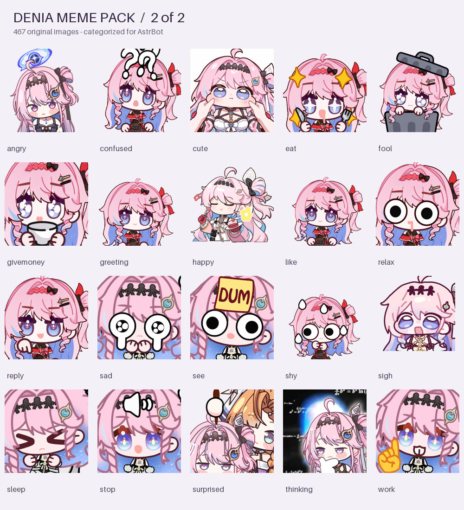

# 达妮娅 AstrBot 表情资源包

共收录 **934张**去重后的达妮娅相关表情，分为 **2卷**。当前分支是**第2卷，467张**。为适配插件单次安装归档的1 GiB上限，分卷保留原图及原动画，不进行压缩重编码。

## 从 GitHub 安装

插件 WebUI → 资源包 → 从 GitHub 安装，仓库均填写 **`HoshiKurea/denia-meme-pack`**，包所在目录均填写 **`.`**；按照下表逐卷安装：

| 资源包 | 分支或版本 | 图片数 | 原图体积 |
| --- | --- | ---: | ---: |
| 第1卷 | `master` | 467 | 582.9 MiB |
| 第2卷 | `part-2` | 467 | 582.9 MiB |

每卷拥有独立资源包ID，可同时安装。安装后在「设置中心 → 使用规则」将所需资源包绑定到人格或会话并保存。全部素材都在这个仓库，无需向官方索引提交PR。

## 全部分类

| 分类 | 总张数 | 适用场景 |
| --- | ---: | --- |
| `happy` | 37 | 开心、欢呼、庆祝和轻快的积极回应。 |
| `like` | 97 | 喜欢、赞同、比心、亲近、抱抱或温柔互动。 |
| `angry` | 39 | 表达生气、抗议、差评或友善地佯装发火；不要用于真实威胁。 |
| `sad` | 28 | 难过、哭泣、委屈与遗憾；认真安慰时谨慎使用搞笑表情。 |
| `confused` | 15 | 疑问、不解、迷惑和需要进一步说明的场景。 |
| `shy` | 18 | 害羞、脸红、心虚或不好意思的回应。 |
| `sleep` | 43 | 困倦、睡觉、晚安、疲惫和休息。 |
| `eat` | 83 | 吃东西、喝饮料、食物和甜点相关的闲聊。 |
| `work` | 50 | 工作、学习、打字、努力做事和任务推进。 |
| `greeting` | 26 | 打招呼、挥手、欢迎、早安、道别和再见。 |
| `sigh` | 16 | 无语、无奈、叹气、扶额和轻微抱怨。 |
| `surprised` | 26 | 惊讶、震惊、受到惊吓或意料之外的情况。 |
| `see` | 35 | 观望、偷看、探头、盯着看和持续关注。 |
| `thinking` | 31 | 思考、沉思、摸下巴、大脑过载和暂时卡住。 |
| `fool` | 225 | 搞怪、整活、唱跳、玩耍和轻松活跃气氛。 |
| `cute` | 63 | 捏捏、戳戳、揉脸、卖萌和普通可爱互动。 |
| `givemoney` | 26 | 红包、付款、要米、硬币和打赏相关的玩笑；不代表真实付款请求。 |
| `stop` | 17 | 摇头、停止、拒绝、静音和表达轻微边界。 |
| `reply` | 35 | 说话、回应、通知、提示和指向对方等普通交流。 |
| `relax` | 23 | 放松、冒泡、日常闲聊和休息中的轻松回应。 |
| `misc` | 1 | 尚无明确情绪标签的其他达妮娅表情；优先用于选图浏览或进一步语义化。 |

## 收录范围与来源

处理范围为[呜哇小站](https://emoji.wuwa.games/tags/character-daniya)公开API列出的32个相关专辑，共1224条记录，不声称覆盖整个互联网。混合角色合集经缩略图核对，排除274条不含目标角色的记录；其余950条按原文件SHA-256去除16条重复，得到934张图片。不同尺寸、服装、动作或编码版本分别保留。

分类依据为原素材动作标签与模糊、混合角色条目的预览复核。`misc`表示暂无明确情绪标签，可继续在插件内语义化；来源标签不是逐帧视觉描述。语义元数据附有标签来源说明，不携带向量模型或服务商配置。

## 索引与授权

- [本卷逐图索引JSON](indexes/included-images.json) / [CSV](indexes/included-images.csv)
- [全部图片及所在分支](indexes/all-images.json)
- [统计](indexes/summary.json) / [来源记录](indexes/source-catalog.json) / [原专辑及画师](indexes/source-packs.json)
- [语义元数据](semantic_metadata.json) / [整理与排除记录](indexes/curation.json)

保留原始GIF/PNG/JPEG/WebP字节、来源专辑、资源标识、画师署名、哈希、尺寸和帧数。未去水印，未保存短效下载票据。使用者已确认取得图库素材打包上传公开GitHub仓库的许可，权利仍归原作者及相关权利人，详见[LICENSE.md](LICENSE.md)。这是玩家整理项目。

发布时验证图片可解码性、官方manifest与semantic JSON Schema、文件路径、SHA-256、语义条目ID和每卷归档大小。未声称在用户的AstrBot实例内完成聊天发送测试。
